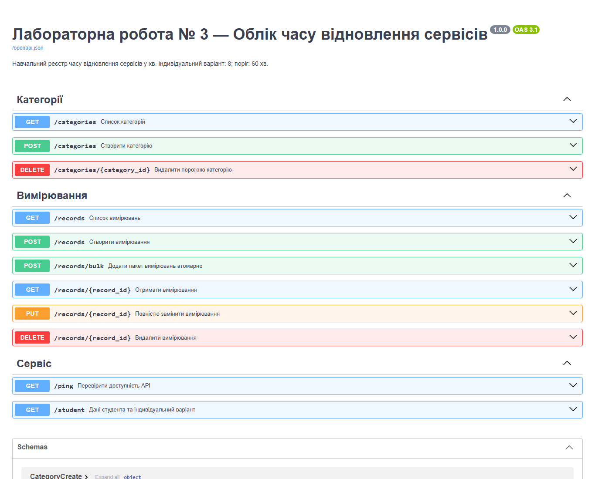

# Звіт до лабораторної роботи № 3

**Дисципліна:** Python для задач кібербезпеки  
**Студент:** Гресько Владислав Ігорович  
**Група:** КБ-206  
**Індивідуальний варіант:** 8

## 1. Мета та предметна область

Мета роботи — створити Web API на FastAPI, зберігати дані в SQLite, перевіряти
запити за допомогою Pydantic, використовувати параметризований SQL та
забезпечити атомарність пакетної операції.

Варіант 8 описує навчальні вимірювання часу відновлення сервісів. Категорії
`database`, `web_service` і `file_storage` позначають сервіс, для якого зроблено
вимірювання. `value` — тривалість у хвилинах, мінімум 0; навчальний поріг —
60 хв. `status` показує стан опрацювання: `new`, `in_progress` або `done`.
Порогове значення задає орієнтир для фільтрації, а не діагноз реальної аварії.

## 2. Структура проєкту

```text
cybersecurity-python-labs/
├── requirements.txt
├── shared/
│   └── student.py
└── labs/
    ├── lab01/
    ├── lab02/
    └── lab03/
        ├── data/seed.json
        ├── screenshots/swagger-ui.png
        ├── routers/categories.py
        ├── routers/records.py
        ├── config.py
        ├── database.py
        ├── main.py
        ├── repository.py
        ├── schema.sql
        ├── schemas.py
        ├── seed.py
        ├── README.md
        └── REPORT.md
```

Шлях до SQLite визначено відносно `database.py`. Програма створює
`labs/lab03/data/lab3.sqlite3`; базовий файл і його журнали ігноруються Git.
Відтворюваними в Git залишаються схема та навчальний JSON.

## 3. Схема бази даних

Таблиця `categories` має первинний ключ `id` і унікальне ім'я завдовжки 2–40
символів. Таблиця `records` має первинний ключ `id`, унікальний `code`, назву,
зовнішній ключ `category_id`, тривалість `value` і статус. Код має 3–40
символів, назва — 3–120, `value` є скінченним числом не меншим за нуль,
статус — одним із трьох дозволених. `ON DELETE RESTRICT` не дозволяє видалити
категорію, на яку посилаються записи. Зв'язок — один-до-багатьох:
одна категорія може мати кілька вимірювань.

`schema.sql` дослівно використовує спільний початок і завершення методички та
готовий блок для варіантів 7–9. Для кожного з'єднання додатково вмикається
`PRAGMA foreign_keys = ON`.

## 4. Початкові дані варіанта 8

| № | Код | Категорія | Час, хв | Статус |
| ---: | --- | --- | ---: | --- |
| 1 | V08-01 | database | 75.0 | new |
| 2 | V08-02 | web_service | 20.0 | in_progress |
| 3 | V08-03 | file_storage | 40.0 | done |
| 4 | V08-04 | database | 90.0 | new |
| 5 | V08-05 | web_service | 35.0 | done |
| 6 | V08-06 | file_storage | 65.0 | in_progress |
| 7 | V08-07 | database | 55.0 | done |
| 8 | V08-08 | web_service | 60.0 | new |

Назва запису формується як «Вимірювання відновлення NN». Ідентифікатори
категорій у початковому наборі — 1, 2, 3; id записів створює SQLite.
`seed.py` перевіряє структуру й точні дані варіанта, а потім у одній транзакції
додає всі три категорії та вісім записів. Якщо база вже не порожня, повторне
заповнення завершується без змін.

## 5. Реалізація

- `database.py` відкриває окреме з'єднання для кожної операції, вмикає зовнішні
  ключі, виконує готовий SQL-скрипт і закриває з'єднання.
- `repository.py` містить усі SQL-запити. Введені значення передаються
  плейсхолдерами `?`; вибірки `records` виконують `JOIN` із `categories`.
- `schemas.py` визначає окремі моделі створення, заміни та читання. Невідомі
  поля заборонені, рядки обрізаються, текст має задані межі, id додатні,
  `value` скінченне й не від'ємне, статус обмежений набором станів.
- `routers/` перетворює очікувані помилки репозиторію на HTTP 404 та 409.
  Некоректні запити FastAPI/Pydantic повертає як 422; видалення повертає 204
  без тіла.
- `POST /records/bulk` спершу отримує весь масив, перевірений Pydantic, потім
  перевіряє категорії та вставляє всі елементи у межах однієї транзакції.
  Виняток скасовує також уже вставлений перший елемент.
- `/student` читає ім'я, групу й номер варіанта з `shared/student.py`; значення
  не дублюються в маршруті.

## 6. API та результати перевірки

Запуск і повний перелік маршрутів наведено в [README.md](README.md). Після
перевірки розробленого API тут зафіксовано сценарії запуску seed, доступності,
CRUD, фільтрів, помилок валідації, конфліктів і відкату транзакції.

### Команди відтворення

```powershell
python -m pip install -r requirements.txt
python -m labs.lab03.seed
python -m uvicorn labs.lab03.main:app --reload --host 127.0.0.1 --port 8000
```

Інтерактивна документація: `http://127.0.0.1:8000/docs`.

### Знімок Swagger UI

Нижче показано згенеровані маршрути, групи операцій і схеми моделей.



### Журнал перевірки

- `python -m labs.lab03.seed`: додано 3 категорії та 8 записів. Повторний запуск
  повідомив про наявні дані; у базі залишилося 3 категорії й 8 записів.
- `GET /ping`, `/student`, `/categories`: 200; студент, група, варіант і назви
  трьох категорій відповідають спільним та індивідуальним даним.
- Повний цикл запису: `POST` 201, `GET` 200, повний `PUT` 200 із незмінним id,
  `DELETE` 204 без тіла; повторне читання видаленого id — 404.
- Фільтри категорії + статусу + `min_value=60` повернули `V08-01` і `V08-04`
  у порядку id. `limit=1&offset=1` повернув `V08-04`. Фільтр для невідомої
  категорії повернув порожній список. Рядок пошуку `' OR 1=1 --` оброблено як
  буквальний текст; кількість записів не змінилася.
- Від'ємний і нечисловий `value`, порожній заголовок, недозволений статус,
  зайве поле, булевий `category_id` і `limit=0` повернули 422. Кількість записів
  лишилась 9 (початкові 8 та один запис CRUD); додавання з невідомою категорією
  повернуло 404.
- Повторна назва категорії та код запису повернули 409. Видалення категорії з
  вимірюваннями повернуло 409; порожню категорію видалено з кодом 204.
- Коректний пакет із двох записів збережено з кодом 201. Пакет із дублікатом
  повернув 409, а пакет із невідомою категорією — 404. В обох випадках кількість
  лишилась 11, а перший новий код відсутній у базі.
- Після перезапуску сервера створений запис залишився доступним. `GET
  /openapi.json` повернув 200; `PRAGMA integrity_check` повернув `ok`.
- API перевірено на FastAPI 0.143.3, Pydantic 2.14.1 та Uvicorn 0.54.0;
  Ruff 0.17.0 використано з наявним `ruff.toml`.
- `ruff check labs/lab03` і `ruff format --check labs/lab03` завершилися успішно.
  Після додавання лабораторної `ruff check --no-cache .` пройшов для всього
  репозиторію, а `ruff format --check --no-cache .` підтвердив формат усіх 33
  Python-файлів.

## 7. Контрольні питання

1. **Таблиця, запис, поле.** Таблиця містить однотипні сутності, рядок описує
   одну сутність, стовпець — окрему властивість. Тут таблиці зберігають
   категорії сервісів і вимірювання їх відновлення.
2. **Первинний і зовнішній ключі.** `categories.id` однозначно визначає
   категорію; `records.category_id` посилається на неї. Нескінченна
   категорія призводить до 404 під час створення або заміни вимірювання.
3. **SQLite проти CSV/JSON.** SQLite дає індексовані запити, транзакції,
   унікальність, зовнішні ключі та перевірки цілісності. JSON тут зручний як
   переносний набір початкових даних, а не як робоче сховище API.
4. **Параметризований SQL.** Запит і значення передаються окремо, тому текст
   користувача не виконується як SQL. `?` задає значення, а ім'я таблиці чи
   оператора є частиною структури запиту.
5. **Транзакція пакета.** Вона гарантує «все або нічого». Окремий commit для
   кожного елемента залишив би частково записаний пакет після помилки.
6. **`with connection`.** Контекст підтверджує транзакцію при успіху або
   скасовує при винятку, але не закриває SQLite-з'єднання; для цього код
   використовує `contextlib.closing`.
7. **HTTP і CRUD.** GET читає (`SELECT`), POST створює (`INSERT`), PUT замінює
   (`UPDATE`), DELETE видаляє (`DELETE`). PUT отримує всі змінювані поля, щоб
   однозначно замінити весь стан ресурсу.
8. **Параметри маршруту, запиту й тіла.** `record_id` у
   `/records/{record_id}` — параметр шляху; `status`, `limit` і `q` у
   `/records?...` — параметри запиту; JSON із полями запису — тіло POST/PUT.
9. **Pydantic.** Перевіряє типи, довжини, межі, допустимий статус, зайві поля,
   скінченність `value` та кількість елементів пакета.
10. **`response_model`.** Описує й перевіряє формат відповіді, створює схеми
    OpenAPI та не повертає випадкові внутрішні поля.
11. **Чому клієнт не задає `id`.** Ідентифікатор має створювати база; це
    запобігає конфліктам і зміні чужого ресурсу через довільний ключ.
12. **HTTP-коди.** 201 — створено; 204 — успішно видалено без представлення;
    404 — id або категорії немає; 409 — дублікат або зайнята категорія;
    422 — запит не проходить валідацію. Для 204 немає JSON-тіла за семантикою
    HTTP.
13. **Початковий JSON і файл SQLite.** JSON і схема потрібні для відтворення
    бази після клонування; SQLite містить робочий стан, який може змінюватися
    під час демонстрації, тому його не додають до Git.

## 8. Висновок

Реалізовано навчальний сервіс на FastAPI зі SQLite для варіанта 8. Запити
перевіряються до виконання, SQL-значення передаються параметризовано, зв'язок
між таблицями забезпечено зовнішнім ключем, а пакетна вставка виконується
атомарно. Початковий JSON і схема дозволяють повторно створити дані; робоча
база не зберігається в репозиторії.
